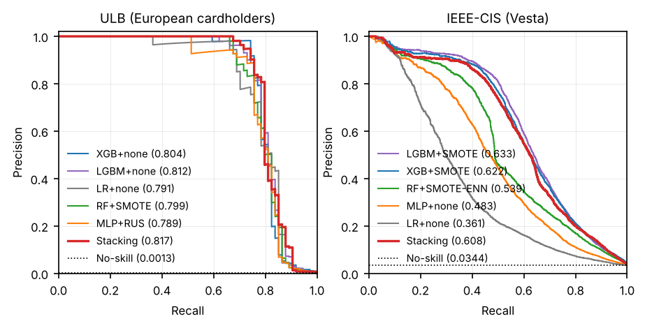
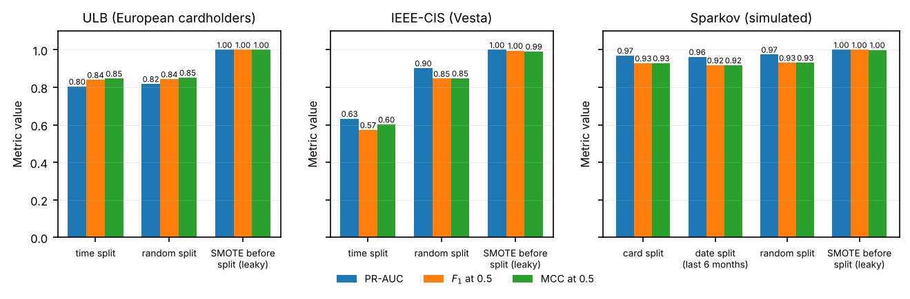

# Credit Card Fraud Detection

Code and results for the diploma project *Development of a Machine Learning System for Credit Card Fraud
Detection Using Transaction Data* (Ravil Serikuly, Viktor Lipkalov, Aiganym Bostanbaeva).

The study compares five classifiers (logistic regression, random forest, XGBoost, LightGBM, MLP) with four
balancing settings (none, random undersampling, SMOTE, SMOTE-ENN) on three public datasets: ULB, IEEE-CIS and
Sparkov. That gives 20 configurations per dataset and 60 in total. On top of them, a stacking model with a
decision threshold tuned on out-of-fold predictions is built for each dataset. The research questions are:

- **RQ1.** Does balancing help when it is applied only to the training data?
- **RQ2.** Do ROC-AUC, PR-AUC, F2 and MCC rank the models in the same order?
- **RQ3.** How does a tuned decision threshold change the balance between detected frauds and false alarms?

## Main results

Best configuration of each dataset, chosen by cross-validated PR-AUC (the test set was not used for the choice):

| Dataset | Best configuration | CV PR-AUC | Test PR-AUC [95% CI] | Test ROC-AUC | LR baseline, test PR-AUC | Test fraud rate |
|---|---|---|---|---|---|---|
| ULB | RF + SMOTE | 0.818 ± 0.024 | 0.799 [0.711, 0.879] | 0.987 | 0.791 | 0.13% |
| IEEE-CIS | LightGBM, no balancing | 0.639 ± 0.030 | 0.634 [0.620, 0.648] | 0.923 | 0.361 | 3.44% |
| Sparkov | LightGBM, no balancing | 0.971 ± 0.008 | 0.970 [0.961, 0.978] | 0.999 | 0.626 | 0.54% |

- **Classifiers.** Tree ensembles were the best models on all three datasets. On ULB the 20 configurations lie
  between 0.748 and 0.816 test PR-AUC, and none differs significantly from the best one (the test set has only
  74 frauds).
- **RQ1.** Balancing applied only to the training data improved PR-AUC significantly in 5 of 45 comparisons (all on
  IEEE-CIS) and lowered it in 19. Random undersampling and the MLP lost the most.
- **RQ2.** On ULB, ROC-AUC and PR-AUC rank the 20 configurations almost independently (Spearman correlation 0.25,
  against 0.92 on IEEE-CIS and 0.89 on Sparkov).
- **RQ3.** Thresholds tuned by F2 were far below 0.5 (0.014–0.034 for the stacking model). At 0.5 the ULB
  stacking model flags no transaction; on IEEE-CIS the tuned threshold raises recall from 0.341 to 0.694 while the
  false positive rate grows from 0.13% to 5.0%.
- **Stacking.** Stacking did not improve PR-AUC over the best single model (0.806 vs 0.799 on ULB, not significant;
  significantly lower on IEEE-CIS and Sparkov) and was close to a plain average of the base models.
- **Leakage check.** Applying SMOTE to the whole dataset before a random split, as several published studies do,
  raises PR-AUC to 0.995–1.000 on all three datasets.





All tables are in [`experiments/results/results_all.xlsx`](experiments/results/results_all.xlsx) (one sheet per
table) and in `experiments/results/tables/*.csv`; vector figures are in `experiments/results/figures/*.pdf`.
[`experiments/results/README.md`](experiments/results/README.md) describes every sheet and lists the deviations
from the original plan.

## Evaluation protocol

1. **Splits.** ULB and IEEE-CIS are split by time: the first 80% of transactions for training, the last 20% for
   testing. Sparkov is split by card: 200 of the 999 cards, with all their transactions, form the test set, so no
   card appears in both parts.
2. **Cross-validation.** Five forward-chaining folds on ULB and IEEE-CIS (train on blocks 1..k, validate on block
   k+1) and five card-grouped folds on Sparkov.
3. **No leakage from the test period.** Feature statistics, IEEE-CIS feature selection, imputation, scaling and
   balancing are fitted on the training part of each fold only.
4. **Metrics.** PR-AUC (average precision) is the main metric. ROC-AUC, and precision, recall, F2, MCC and FPR at a
   threshold, are also reported.
5. **Threshold.** The threshold that maximises F2 is chosen on out-of-fold predictions, never on the test set.
6. **Statistics.** Paired stratified bootstrap (2,000 resamples; by card on Sparkov), DeLong test for ROC-AUC on
   ULB and IEEE-CIS, Holm correction within each set of comparisons.
7. **Single use of the test set.** Each final model is retrained on the whole training part and evaluated once.

## Data

The datasets are not included. Download them from Kaggle (an account is required; for IEEE-CIS you also have to
accept the competition rules) and place the files as follows:

| Dataset | Source | Files |
|---|---|---|
| ULB Credit Card Fraud | https://www.kaggle.com/datasets/mlg-ulb/creditcardfraud | `data/ulb/creditcard.csv` |
| IEEE-CIS Fraud Detection | https://www.kaggle.com/competitions/ieee-fraud-detection/data | `data/ieee/train_transaction.csv`, `data/ieee/train_identity.csv` |
| Sparkov (simulated) | https://www.kaggle.com/datasets/kartik2112/fraud-detection | `data/sparkov/fraudTrain.csv`, `data/sparkov/fraudTest.csv` |

```bash
kaggle datasets download -d mlg-ulb/creditcardfraud -p data/ulb --unzip
kaggle competitions download -c ieee-fraud-detection -p data/ieee
kaggle datasets download -d kartik2112/fraud-detection -p data/sparkov --unzip
```

`data/`, `artifacts/` and the experiment caches are git-ignored.

## Reproducing the experiments

```bash
python -m venv .venv
source .venv/bin/activate        # Windows: .venv\Scripts\activate
pip install -e ".[experiments]"

bash experiments/run_all.sh      # ULB and IEEE-CIS
bash experiments/run_sparkov.sh  # Sparkov, then figures and tables for all three datasets
```

Both scripts are restartable: finished configurations and search trials are skipped. Logs go to
`experiments/logs/`, intermediate arrays to `experiments/cache/`, and tables and figures to `experiments/results/`.
The script-by-script description is in [`experiments/README.md`](experiments/README.md).

The reported results were obtained with Python 3.13.16, scikit-learn 1.9.1, imbalanced-learn 0.14.2,
XGBoost 3.4.1, LightGBM 4.7.0, PyTorch 2.14.1 (CPU), pandas 3.0.5, NumPy 2.5.3, SciPy 1.18.1 and
matplotlib 3.11.2, with random seed 42 everywhere. On a cloud Linux machine with 2 vCPUs (Xeon, 2.1 GHz),
7 GB of RAM and no GPU, hyperparameter search took about 3.1 h (ULB), 5.9 h (IEEE-CIS, plus 47 min to build the
features of each fold) and 6.8 h (Sparkov), and final training 0.7, 1.6 and 2.2 h: about 21 h in total.

Because of these limits, the random-search budget is small (4 to 10 trials per configuration), SMOTE-ENN on
IEEE-CIS and Sparkov uses a fixed resampling ratio of 0.1, and the Sparkov models are trained on 399 of the 799
non-test cards. The test set is not reduced.

## Repository structure

```
experiments/            thesis experiments: data preparation, grid search, statistics, stacking, figures
  results/              tables (xlsx, csv, LaTeX), figures (pdf, png), selected IEEE-CIS features
src/fraud_detection/    reusable package
  data.py               loading of the Kaggle files, chronological / random split
  features.py           feature builders fitted on the training data only (ULB, IEEE-CIS)
  models.py             logistic regression, random forest, XGBoost, LightGBM with class-imbalance handling
  evaluation.py         PR-AUC, ROC-AUC, F1/F2, MCC, precision@k, fraud-amount recall, plots
  train.py              CLI: train and compare models, save the best one to artifacts/<dataset>/
  predict.py            CLI and FraudScorer class: score new transactions with a saved model
tests/                  pytest suite on synthetic data (no Kaggle download needed)
```

## Using the `fraud_detection` package

The package is a simpler, standalone pipeline for ULB and IEEE-CIS. It uses a chronological train / validation /
test split (60/20/20 by default), picks the threshold on the validation set and saves the best model. It is
separate from the thesis experiments above.

```bash
pip install -e ".[dev]"
pytest

python -m fraud_detection.train --dataset ulb --data-dir data/ulb
python -m fraud_detection.train --dataset ieee --data-dir data/ieee          # ~6-8 GB RAM; --nrows 200000 for a quick run
python -m fraud_detection.train --dataset ulb --data-dir data/ulb --imbalance smote --output-dir artifacts/ulb_smote
```

Outputs in `artifacts/<dataset>/`: `metrics.csv` (validation and test metrics of every model), `summary.json`,
`curves_test.png` (PR and ROC curves), the confusion matrix and SHAP feature importance of the best model, and
`model.joblib` (feature builder, model and threshold).

```bash
python -m fraud_detection.predict --model artifacts/ieee/model.joblib \
    --input data/ieee/test_transaction.csv --identity data/ieee/test_identity.csv --output scored.csv
```

```python
from fraud_detection.predict import FraudScorer
scores = FraudScorer("artifacts/ulb/model.joblib").score(transactions_df)
```

## Limitations and future work

ULB covers only two days of 2013 and its features are anonymised by PCA; Sparkov is simulated, so results on it
show stability rather than real bank performance. SMOTE and ENN treat encoded categories as numbers. Possible next
steps: a larger tuning budget, SMOTE-NC for categorical features, a threshold chosen from the number of alerts a
bank can review or from the cost of errors, and sequence models over a card's transaction history on Sparkov.
